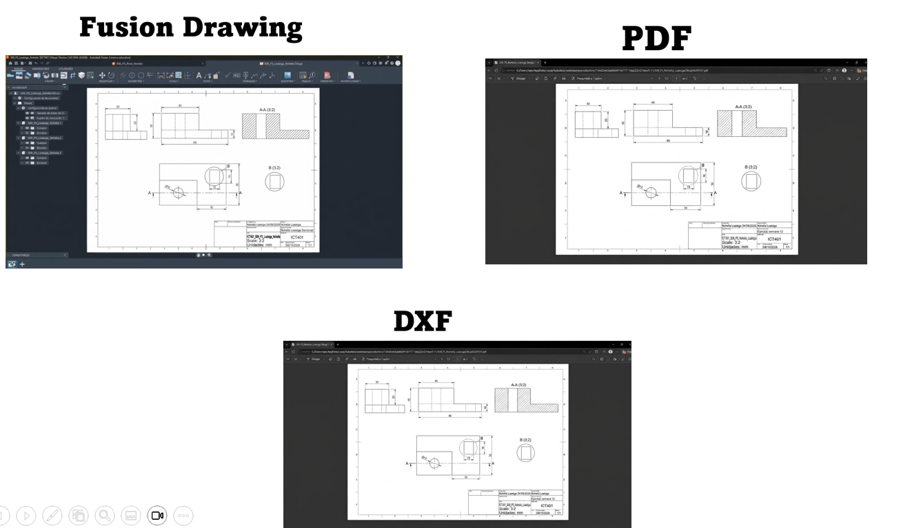

# ICT401 · Semana 12 — Registro de formato, cajetín y salidas técnicas

5 al 10 de octubre de 2026.

- Estudiante: [Nohelia Loaisiga Sandoval.]
- Grupo: [60]
- Proyecto de Fusion Cloud con acceso docente: [Nohelia Loaisiga]
- Drawing de referencia de Semana 11: [ICT401_S09_P3_Loaisiga_Nohelia Dibujo]
- Modelo utilizado: [Nombre del diseño]
- Laboratorio integrador II-A: [Respuesta]
- Fase 2 del Proyecto: [Respuesta]

## Instrucciones

Utilice esta plantilla en la carpeta o plataforma oficial de entrega indicada por la persona docente y guárdela como `S12_Registro_Apellido_Nombre.md`. Sustituya `Apellido_Nombre` por un apellido y un nombre sin espacios ni tildes. Complete cada `[Respuesta]` y agregue las imágenes solicitadas junto con la ficha.

Conserve las decisiones iniciales y documente las correcciones. No borre una decisión anterior: explique qué cambió, qué problema motivó el cambio y cómo comprobó el resultado.

Trabaje sobre el modelo y el Drawing de Semana 11. Use milímetros, orientación coherente y el mismo proyecto de Fusion Cloud. Esta ficha registra el proceso; complétela durante cada lección, no al final de memoria.

**Ayuda de Fusion:** para comandos de Drawing consulte Autodesk Fusion Help, sección `Drawings`: <https://help.autodesk.com/view/fusion360/ENU/>. En esta ficha se utilizan `Design > File > New Drawing > From Design`, `Output > PDF`, `Output > DXF`, `Output > Print`, `Edit Sheet` y `Edit Title Block`. Si su versión utiliza otra etiqueta, escriba el nombre real del comando y adjunte la captura del cuadro o panel utilizado.

**Límite:** no modifique la geometría para resolver problemas de formato. No adelante ensamblajes, vistas explosionadas, fabricación digital ni control dimensional metrológico.

## Cómo funciona el Laboratorio integrador II-A

El laboratorio es un proceso acumulativo de cinco etapas. **P1, P2, P3 y P4 son prácticas formativas**: en cada una toma una decisión, realiza una corrección y conserva evidencias para continuar. **P5 no es un plano nuevo ni una actividad independiente**; utiliza el Drawing corregido durante P1–P4 para realizar la revisión final, comprobar las salidas y organizar la entrega.

| Etapa | Función | Resultado que pasa a la siguiente etapa |
|---|---|---|
| P1 | Diagnosticar el plano y seleccionar formato, orientación y escala. | Decisión justificada y estado inicial documentado. |
| P2 | Aplicar la hoja, distribuir vistas y completar el cajetín. | Drawing organizado y correcciones registradas. |
| P3 | Controlar escala, legibilidad, cotas, tolerancias y anotaciones. | Drawing validado o correcciones pendientes identificadas. |
| P4 | Exportar PDF/DXF y comparar las salidas con el Drawing. | Archivos revisados y discrepancias corregidas o registradas. |
| P5 | Integrar, revisar, imprimir y entregar el plano final. | Producto evaluable y evidencias finales. |

P5 corresponde al **Laboratorio integrador II-A, con valor de 10 %**. La **Fase 2 del Proyecto, con valor de 7 %**, utiliza este mismo proceso y registro, pero se entrega además conforme a su enunciado y rúbrica oficiales. Conserve las decisiones y capturas de P1–P4: forman parte de la trazabilidad del laboratorio y no se sustituyen por una sola captura del resultado final.

## Criterios normativos transversales

Use las referencias normativas disponibles en el aula virtual como criterios de control. No declare conformidad normativa solo porque el archivo tenga la extensión correcta o porque una configuración sea la predeterminada de Fusion.

| Referencia | Qué se revisa en esta semana | Evidencia o registro requerido |
|---|---|---|
| ISO 5457 | Formato, orientación, marco y zona útil de la hoja. | Decisión de formato justificada y captura de la hoja completa. |
| INTE/ISO 7200:2008, 5--6 | Espacios de información y composición del cajetín. | Campos identificables, número de identificación, fecha, título, autor, estado o revisión y datos de hoja cuando correspondan. |
| ISO 128-1:2020 e ISO 128-3 | Coherencia de representación, vistas, cortes y secciones. | Alineación, identificación de corte o detalle y comparación con el modelo. |
| ISO 129-1:2018, 4--6 | Necesidad, unicidad, ubicación y legibilidad de cotas; revisión de tolerancias existentes. | Tabla de control de anotaciones y capturas ampliadas. |
| ISO 16792:2021, 4--5.3 | Integridad y relación entre modelo, Drawing, archivos exportados, identificación y revisión. | Enlace de Fusion, nombres de archivos, versión o revisión y comparación de salidas. |

### Registro de aplicación normativa

| Referencia | Apartado o criterio aplicado | Evidencia asociada | Resultado o limitación |
|---|---|---|---|
| ISO 5457 | [Respuesta] | [Nombre de imagen o captura] | [Conforme/Limitación] |
| INTE/ISO 7200:2008 | [Respuesta] | [Nombre de imagen o captura] | [Conforme/Limitación] |
| ISO 128-1/128-3 | [Respuesta] | [Nombre de imagen o captura] | [Conforme/Limitación] |
| ISO 129-1 | [Respuesta] | [Nombre de imagen o captura] | [Conforme/Limitación] |
| ISO 16792:2021 | [Respuesta] | [Nombre de imagen o captura] | [Conforme/Limitación] |

Si la plantilla o la versión de Fusion no permite mostrar un dato, escriba la limitación concreta. Las medidas propias de la actividad deben identificarse como decisiones didácticas, no como dimensiones ISO.

## P1 — Diagnóstico del plano y selección del formato

**Propósito:** analizar el Drawing de Semana 11 y seleccionar formato, orientación y escala inicial.

**Entorno:** Fusion, espacios `Design` y `Drawing`. En P1 no se modifica la geometría.

### P1.0 · Pasos en Fusion

1. Abra Fusion y seleccione el proyecto que contiene el modelo de Semana 11.
2. En `Design`, confirme que el cuerpo y las características coinciden con el Drawing anterior. No edite la geometría.
3. Abra el Drawing y confirme que aparecen vistas, corte o sección, detalle, cotas y tolerancias cuando correspondan.
4. En el navegador, seleccione la hoja y abra la opción de edición de hoja, normalmente `Edit Sheet`.
5. Registre formato, orientación y unidades actuales sin aplicar todavía cambios.
6. Observe la hoja completa y anote al menos tres problemas de espacio o legibilidad.
7. Compare las alternativas de formato de la plantilla.
8. Elija formato, orientación y escala inicial según la información que debe conservarse.
9. Guarde la justificación en esta ficha y conserve una captura del estado inicial.

### P1.1 · Estado de referencia

- Nombre del proyecto Fusion: [ Nohelia Loaisiga]
- Nombre del diseño: [Componente Principal]
- Nombre del Drawing: [CT401_S09_P3_Loaisiga_Nohelia Dibujo]
- Formato actual: [ISO A4]
- Orientación actual: [Vertical]
- Unidades: [mm]
- Escala actual de la hoja o vistas: [ 1:2.5]

### P1.2 · Diagnóstico

| Problema observado | Ubicación exacta en la hoja | Por qué afecta la entrega | Corrección prevista |
|---|---|---|---|
| [Cruce de líneas de cota con geometría] | [ Vista de Perfil Derecha ] | [Confunde contornos visibles con líneas de cota] | [ Desplazar cotas al exterior de la pieza.] |
| [Colisión entre vista isométrica y cajetín ] | [Esquina inferior derecha] | [Tapa campos clave de identificación e información del proyecto] | [Reorganizar disposición de vistas en formato A3] |
| [Sección A-A sin indicación clara] | [Vista Frontal ] | [No se identifica con precisión el plano de corte] | [Reconfigurar escala de texto y etiquetas de corte] |

### P1.3 · Comparación de alternativas

| Alternativa | Ventaja | Limitación | ¿La selecciono? |
|---|---|---|---|
| [ ISO A4 ] | [Ocupa poco espacio digital] | [Espacio insuficiente para sección, detalle e isométrica simultáneamente ] | [No] |
| [ISO A3] | [Espaciado óptimo para distribución según ISO 128] | [Requiere replantear el esquema de ubicación] | [Sí] |

- Formato seleccionado: [ISO A3 (420 x 297 mm)]
- Orientación seleccionada: [Horizontal]
- Escala inicial seleccionada: [1:1 , 3:1]
- Justificación técnica: [ El cambio a formato A3 horizontal soluciona la saturación de espacio previa en A4 vertical, permitiendo cumplir con las distancias mínimas requeridas por ISO 129-1 entre líneas de cota y contornos del componente.]
- Criterio de ISO 5457 aplicado: [Uso de márgenes normalizados de 20 mm en zona de archivado y 10 mm en bordes restantes con cuadro de rotulación en esquina inferior derecha.]
- ¿Qué parte de la selección es una decisión didáctica de la plantilla?: [La inclusión de una vista isométrica sombreada como referencia auxiliar dentro de la misma lámina.]

### Evidencias P1

**Qué debe contener cada imagen:**

- `S12_P1_PlanoInicial_Apellido_Nombre.png`: captura del Drawing completo, con nombre de la hoja o del Drawing visible y suficiente contexto para localizar los problemas.
- `S12_P1_Diagnostico_Apellido_Nombre.png`: una sola lámina con al menos tres problemas marcados y etiquetados sobre el plano.
- `S12_P1_DecisionFormato_Apellido_Nombre.png`: configuración de hoja o alternativa seleccionada, con formato, orientación o escala identificables.

Una captura aislada del cuadro de diálogo no demuestra que el formato sea adecuado para el plano.

## P2 — Aplicación de hoja, distribución y cajetín

**Propósito:** aplicar el formato seleccionado, organizar la información y completar el cajetín.

**Entorno:** Fusion, espacio `Drawing`. No se modifica la geometría del modelo.

### P2.0 · Pasos en Fusion

1. Abra la versión de P1 y confirme que trabaja sobre el Drawing correcto.
2. Seleccione la hoja en el navegador y ejecute `Edit Sheet` o el comando equivalente.
3. Aplique formato, orientación y unidades seleccionados en P1. Acepte la edición.
4. Mantenga juntas las vistas que comparten dimensiones y reserve espacio para cotas y anotaciones.
5. Reubique vistas sin romper la alineación entre `Front`, `Top` y `Right`.
6. Reubique el corte o la sección sin perder su identificación ni su relación con las vistas.
7. Reubique el detalle ampliado sin separarlo de la vista de origen.
8. Haga clic derecho sobre el cajetín y seleccione `Edit Title Block` o el comando equivalente.
9. Complete código ICT401, título de la pieza, nombre del estudiante, fecha, unidades, escala y los demás campos requeridos por la plantilla.
10. Cierre la edición del cajetín y compruebe que ningún texto invada vistas, cotas, rayado o bordes.
11. Guarde el Drawing en Fusion Cloud.

### P2.1 · Configuración aplicada

- Formato final de la hoja: [ ISO A3]
- Orientación: [Horizontal]
- Unidades: [mm]
- Escala escrita en el cajetín: [1:1]
- Escala configurada en las vistas: [1:1 (Detalle 3:1)]
- ¿Coinciden ambas escalas?: [Sí]
- Campos completados del cajetín: [Asignatura, Título de Pieza, DIBUJADO (Nombre), FECHA, ESCALA, UNIDADES, REVISIÓN, PROYECTO]
- Número de identificación del documento: [ICT401-S12-05]
- Fecha de emisión o entrega: [9/10/2026]
- Autor: [Alisson Fernández]
- Estado o revisión: [Rev. A]
- Campos normativos no disponibles en Fusion: [Declaración de material estandarizado en campo independiente del cuadro por defecto]

### P2.2 · Distribución

| Elemento | Posición final | ¿Está alineado o relacionado correctamente? | Corrección realizada |
|---|---|---|---|
| Front | [Superior-izquierda] | [Sí] | [Reubicada para centrar la proyección global] |
| Top | [Inferior-izquierda] | [Sí ] | [Alineada verticalmente con respecto a Front] |
| Right | [Superior-centro] | [Sí ] | [Alineada horizontalmente con respecto a Front] |
| Corte o sección | [Centro-derecha] | [Sí] | [Identificada como Sección A-A con indicación de plano] |
| Detalle | [Inferior-centro] | [Sí ] | [Vinculado a zona de encaje mediante Detalle C] |
| Cajetín | [Inferior-derecha] | [Sí] | [Ajustado a la esquina inferior según INTE/ISO 7200] |

### Evidencias P2

**Qué debe contener cada imagen:**

- `S12_P2_HojaDistribucion_Apellido_Nombre.png`: Drawing completo con formato aplicado, vistas distribuidas, sección, detalle y cajetín en contexto.
- `S12_P2_Cajetin_Apellido_Nombre.png`: recorte legible del cajetín completo, incluyendo código ICT401, título, autoría, fecha, unidades y escala.
- `S12_P2_Correcciones_Apellido_Nombre.png`: comparación antes/después o lámina que muestre una corrección real de distribución.

## P3 — Escala, legibilidad y control de anotaciones

**Propósito:** comprobar que la escala permite leer la hoja completa y las zonas con información técnica.

**Entorno:** Fusion, espacio `Drawing`.

### P3.0 · Pasos en Fusion

1. Abra el Drawing de P2 y registre la escala de la hoja y de cada vista.
2. Observe la hoja completa y localice textos, flechas, cotas, rayado o detalles ilegibles.
3. Acerque el zoom para comprobar textos y dimensiones; vuelva a la vista completa para comprobar composición.
4. Verifique que `Front`, `Top` y `Right` sigan alineadas.
5. Verifique que el corte conserve su identificación y que el detalle tenga letra y escala.
6. Si una vista requiere otra escala, selecciónela y modifique la propiedad de escala desde el panel de Fusion. No la redimensione arrastrando sin control.
7. Reubique la vista si invade otra vista, una cota, el cajetín o el borde de la hoja.
8. Revise que cada cota se asocie con una característica y no dependa de una línea oculta.
9. No agregue nuevas tolerancias en P3. Solo revise las que provienen de Semana 11.
10. Guarde cada corrección en la tabla de esta ficha.

### P3.1 · Control de escala

- Escala antes de la revisión: [1:2.5 ]
- Escala después de la revisión: [1:1]
- ¿Se cambió la escala?: [Sí]
- Motivo de la decisión: [La escala 1:2.5 reducía excesivamente los radios de empalme dificultando la acotación clara.]
- ¿La escala del cajetín coincide?: [Sí]
- ¿Las cotas necesarias aparecen una sola vez, salvo indicación auxiliar?: [Sí]
- ¿Las cotas se ubican en la vista más clara y evitan líneas ocultas?: [Sí]

### P3.2 · Control de legibilidad

| Elemento revisado | Problema encontrado | Corrección | Resultado verificado |
|---|---|---|---|
| Cotas | [Cota lineal sobrepasaba línea del marco] | [Reubicación interna en vista superior] | [Legible] |
| Texto y notas | [Letras de sección pequeñas] | [Incremento de tamaño de etiqueta A-A a 5 mm] | [Legible] |
| Corte o sección | [Achurado muy denso en sección] | [Ajuste de trama del patrón de rayado a escala 1.5] | [Legible] |
| Detalle | [Círculo de detalle cortaba cota] | [Ampliación del radio de la zona C identificada] | [Verificado] |
| Tolerancia | [Tolerancia dimensional amontonada] | [Alineación axial de textos según ISO 129-1] | [Legible] |

### Evidencias P3

**Qué debe contener cada imagen:**

- `S12_P3_HojaCompleta_Apellido_Nombre.png`: hoja completa después de la corrección, sin ocultar el cajetín ni las vistas.
- `S12_P3_Legibilidad_Apellido_Nombre.png`: una lámina con al menos dos recortes ampliados donde se lean cotas y anotaciones.
- `S12_P3_ControlEscala_Apellido_Nombre.png`: escala visible en propiedades de la vista o configuración y escala correspondiente del cajetín.

Si no cambió la escala, la ficha debe explicar por qué la escala inicial conservaba la legibilidad.

## P4 — Salidas PDF/DXF y previsualización técnica

**Propósito:** generar las salidas solicitadas y comprobar que corresponden al Drawing.

**Entorno:** Fusion, espacio `Drawing`, visor PDF y visor CAD disponible.

### P4.0 · Salida PDF

1. Guarde el Drawing y confirme la hoja activa.
2. Abra `Output` y seleccione `PDF` o el comando equivalente.
3. Seleccione únicamente la hoja final solicitada.
4. Utilice el nombre `S12_PlanoFinal_Apellido_Nombre.pdf`.
5. Guarde el archivo en la carpeta de Semana 12.
6. Abra el PDF fuera de Fusion.
7. Compruebe tamaño de papel, orientación, márgenes, cajetín, vistas, cotas, rayado y detalle.
8. Compare el PDF con el Drawing. Si aparece recortado, girado, vacío o deformado, repita la exportación después de corregir la configuración.

### P4.1 · Salida DXF

1. Genere el DXF solamente si la plantilla o la rúbrica lo solicita.
2. En `Output`, seleccione `DXF` o el comando equivalente.
3. Confirme hoja, unidades, nombre y opciones de exportación.
4. Utilice el nombre `S12_PlanoFinal_Apellido_Nombre.dxf`.
5. Guarde el archivo en la carpeta de Semana 12.
6. Abra o previsualice el DXF en el programa disponible.
7. Compruebe que corresponde al Drawing y registre qué elementos contiene.
8. No convierta el archivo con otra herramienta para ocultar una discrepancia. Registre la limitación y consulte si la salida disponible no coincide con la rúbrica.

### P4.2 · Registro de exportación

| Archivo | Comando utilizado | Unidades | Hoja/orientación | ¿Coincide con Drawing? | Corrección |
|---|---|---|---|---|---|
| PDF | [Output > PDF] | [mm] | [ISO A3 / Horizontal] | [Sí] | [Vectorización limpia sin pérdida de fuentes] |
| DXF | [ Output > DXF] | [mm] | [ISO A3 / Horizontal] | [Sí] | [Verificada exportación de capas de cotas y ejes] |

### Evidencias P4

**Qué debe contener cada imagen:**

- `S12_P4_Drawing_Apellido_Nombre.png`: hoja final en Fusion antes de exportar.
- `S12_P4_PDF_Apellido_Nombre.png`: PDF abierto, con hoja, cajetín y contenido técnico visibles.
- `S12_P4_DXF_Apellido_Nombre.png`: DXF abierto o ventana de exportación con nombre y unidades, cuando se solicite.
- `S12_P4_Comparacion_Apellido_Nombre.png`: una sola lámina con recortes etiquetados `Fusion Drawing`, `PDF` y `DXF`.

## P5 — Laboratorio integrador II-A, impresión y entrega

**Propósito:** integrar, revisar y entregar el plano técnico completo a partir del Drawing corregido en P1–P4. P5 es evaluativo; no cree un plano nuevo ni repita el proceso desde cero.

**Valor:** Laboratorio integrador II-A, 10 %. La Fase 2 del Proyecto tiene valor de 7 % y se entrega según su enunciado y rúbrica oficiales.

### P5.0 · Pasos en Fusion

1. Abra el Drawing que conserva las correcciones de P1 a P4.
2. Confirme que el modelo y el Drawing pertenecen al mismo proyecto y pieza.
3. Revise en la hoja completa formato, orientación, márgenes y distribución.
4. Revise el cajetín: código ICT401, título, autoría, fecha, unidades, escala y campos de la plantilla.
5. Revise alineación de `Front`, `Top` y `Right`, sección, detalle, cotas y tolerancias.
6. Cambie a `Design` y compare una característica visible del plano con el modelo 3D.
7. Registre cualquier discrepancia; no maquille el Drawing para que coincida visualmente.
8. Regrese a `Drawing` y aplique la corrección indicada por la revisión.
9. Ejecute `Output > PDF`, abra el PDF y compruebe que no hay recortes ni deformaciones.
10. Ejecute `Output > DXF` únicamente si corresponde y revise su contenido.
11. Abra `Output > Print` o la previsualización de impresión.
12. Compruebe papel, orientación, escala, márgenes y ausencia de recorte. Si se exige escala técnica, no seleccione `Fit to page`.
13. Guarde el Drawing en Fusion Cloud y confirme acceso docente.
14. Organice ficha, imágenes, PDF, DXF y enlaces en la carpeta oficial.
15. Complete el checklist final y registre los pendientes reales.

### P5.1 · Checklist

- [ X ] El modelo y el Drawing corresponden a la misma pieza.
- [ X ] El formato y la orientación son adecuados.
- [ X ] El cajetín está completo y legible.
- [ X ] El formato, marco y zona de identificación fueron revisados con el criterio de ISO 5457.
- [ X ] Los campos del cajetín fueron contrastados con INTE/ISO 7200:2008 y las limitaciones quedaron registradas.
- [ X ] La escala del cajetín coincide con la configuración del plano.
- [ X ] Las vistas están alineadas y no falta información necesaria.
- [ X ] El corte, la sección y el detalle conservan su identificación.
- [ X ] Las cotas y tolerancias son legibles y no están superpuestas.
- [ X ] Las cotas necesarias aparecen una sola vez, salvo indicación auxiliar, y se revisaron con ISO 129-1.
- [ X ] El PDF abre correctamente y coincide con el Drawing.
- [ X ] El DXF fue generado y revisado cuando corresponde.
- [ X ] La previsualización de impresión no presenta recortes ni deformaciones.
- [ X ] La ficha y las imágenes tienen la nomenclatura solicitada.
- [ X ] El enlace de Fusion Cloud tiene acceso docente.
- [ X ] Modelo, Drawing y archivos exportados no presentan contradicciones y la revisión o versión quedó identificada.
- [ X ] La Fase 2 del Proyecto fue entregada según su enunciado.

### P5.2 · Revisión por pares

| Criterio | Observación recibida | Corrección aplicada |
|---|---|---|
| Formato y orientación | [El plano en A4 vertical dificultaba la lectura de la sección A-A] | [ Se adoptó el formato A3 Horizontal según ISO 5457.] |
| Cajetín | [Faltaba la fecha de emisión y la designación de la revisión] | [Se completó con fecha 09/10/2026 y revisión Rev. A.] |
| Escala y legibilidad | [Cotas de diámetro sobrepuestas en la vista de perfil.] | [Se distribuyeron en vista frontal e isométrica según ISO 129-1] |
| Distribución de vistas | [La sección A-A estaba desconectada de su indicación] | [Se desplazó a la zona derecha manteniendo eje de alineación.] |
| PDF/DXF e impresión | [Escala de impresión desajustada al exportar PDF.] | [Se fijó la escala 1:1 en opciones de trazado sin escala de ajuste.] |

### Evidencias P5

**Qué debe contener cada imagen:**

- `S12_P5_PlanoFinal_Apellido_Nombre.png`: hoja completa en Fusion, con cajetín legible y todos los elementos del plano.
- `S12_P5_VerificacionModelo_Apellido_Nombre.png`: comparación etiquetada entre `Drawing` y `Design`, con una orientación que permita comprobar una característica representada.
- `S12_P5_PrevisualizacionImpresion_Apellido_Nombre.png`: previsualización con papel, orientación, escala y márgenes visibles.
- `S12_P5_Entrega_Apellido_Nombre.png`: carpeta o plataforma oficial de entrega mostrando ficha, PDF, DXF cuando corresponda y archivos organizados.

## Reflexión final

### 1. ¿Por qué el formato seleccionado es adecuado para este plano?

[El formato ISO A3 Horizontal ofrece la superficie necesaria para disponer las proyecciones ortogonales, el plano de corte A-A, el Detalle C a escala ampliada 3:1 y la vista tridimensional isométrica, garantizando una lectura despejada de cotas y notas técnicas.]

### 2. ¿Qué información del cajetín identifica o contextualiza el plano?

[El cajetín contextualiza el documento mediante el código de la materia (ICT401), el nombre de la pieza (04_Soporte_Ajustable), el nombre del estudiante (Alisson Fernández), la fecha de entrega, el estado de revisión (Rev. A), las unidades de medida (mm) y la escala general de representación (1:1).]

### 3. ¿Qué problema de escala o legibilidad detecté y cómo lo resolví?

[Detecté que en la escala 1:2.5 en formato A4 las anotaciones de tolerancias dimensionales se traslapaban con las líneas de centro. Lo resolví cambiando a escala 1:1 en hoja A3 y aplicando una vista ampliada de detalle (3:1) para las zonas de acople más pequeñas.]

### 4. ¿Qué diferencia encontré entre el Drawing y la salida exportada?

[El PDF mantuvo una definición vectorial exacta de las líneas de contorno y ejes. En la salida DXF se observó que la geometría se exportó dividida en bloques organizados por capas de cotas y textos, facilitando su lectura en entornos CAD de terceros.]

### 5. ¿Cómo comprobé que la impresión no deformara ni recortara el plano?

[Mediante la vista previa de Output > Print, seleccionando la configuración de tamaño de papel ISO A3, orientación Horizontal y asegurando la opción de escala 100% (sin activación de Fit to page) para evitar deformaciones dimensionales.]

### 6. ¿Qué corrección mejoró más la calidad del plano?

[La reubicación exterior de las cotas y el ordenamiento de los textos de sección, eliminando cruces con la geometría del modelo y aplicando rigurosamente los lineamientos de la norma ISO 129-1.]

## Cierre de la ficha

- [ x ] Completé las respuestas de P1 a P5.
- [ x ] Incorporé todas las evidencias con la nomenclatura solicitada.
- [ x ] Las imágenes se visualizan correctamente desde el medio oficial de entrega.
- [ x ] El PDF fue abierto y comparado con el Drawing.
- [ x ] El DXF fue revisado cuando correspondía.
- [ x ] El modelo y el Drawing están disponibles en Fusion Cloud con acceso docente.
- [ x ] Documenté las correcciones sin borrar decisiones iniciales.
- [ x ] La Fase 2 del Proyecto fue organizada según su rúbrica.
- [ x ] Entregué los últimos cambios mediante el medio oficial indicado.

Nombre sugerido para la entrega: `S12_PlanoFinal_Apellido_Nombre`.

Si realiza una corrección posterior, conserve la versión anterior y utilice una identificación que permita distinguir la nueva entrega.
